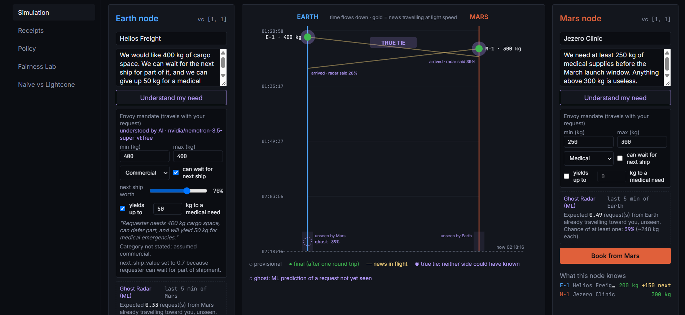
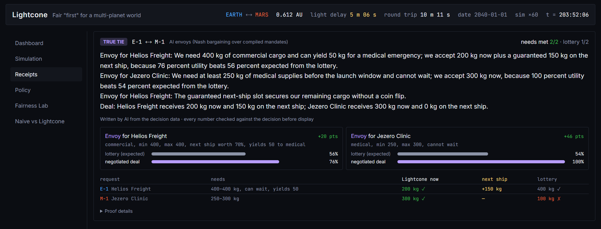
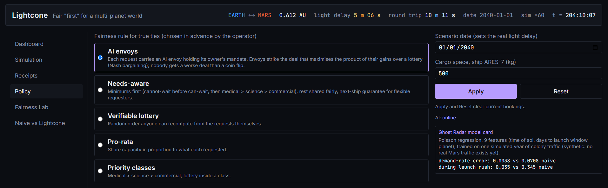
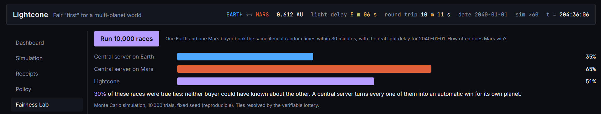
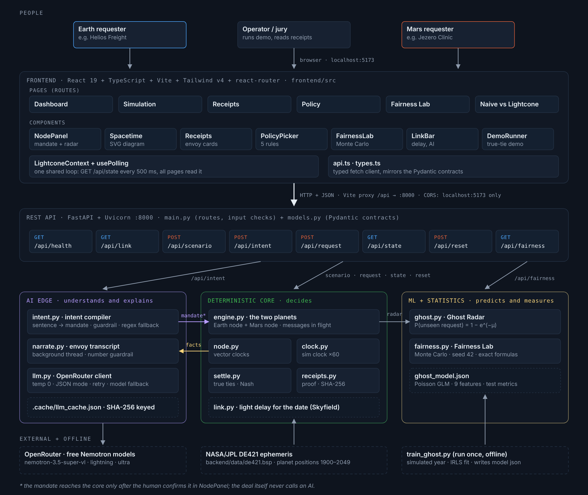
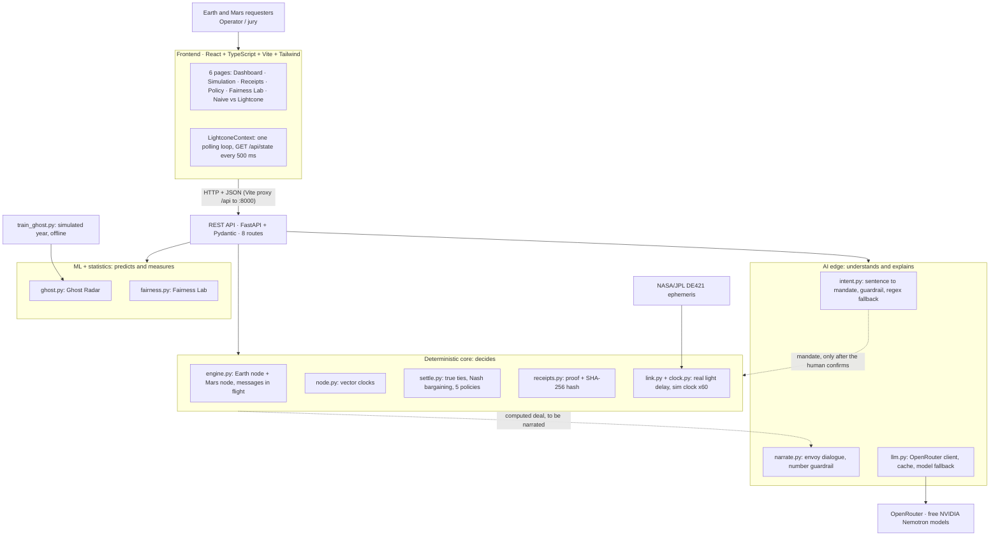
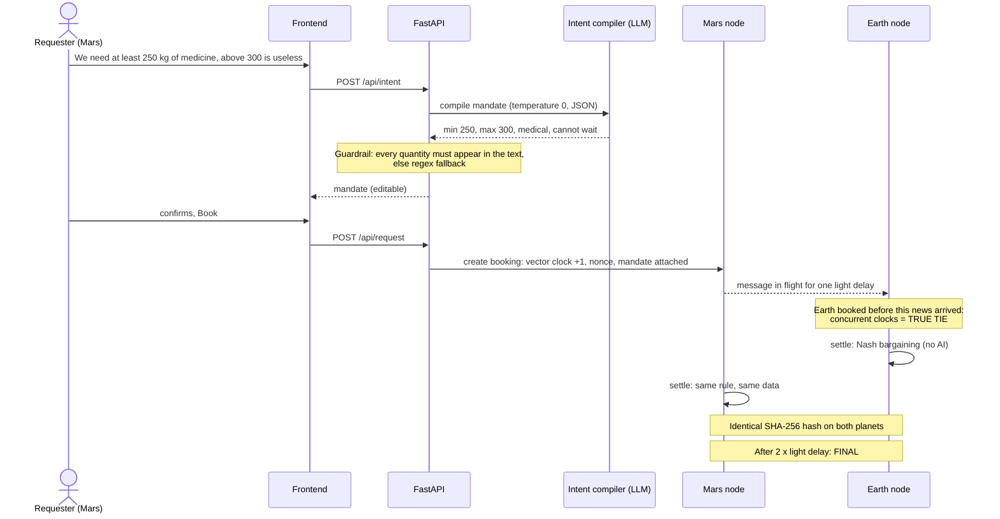

# Lightcone

**Fair "first" between Earth and Mars.** IEEE Lumen 2.0 · Beyond 2030 · Team: Narimane Mezned, Shahd Sghaier (INSAT)

> In 1905, Einstein showed that "at the same time" depends on where you stand.
> In 2040, it becomes a customer-service problem.

A message between Earth and Mars takes **3 to 22 minutes**. When both planets book the same scarce resource within that delay, neither side could have known about the other, so "who was first?" has no honest answer. Lightcone **detects** these *true ties*, **settles** them fairly with AI envoys and game theory, and **proves** the result with a receipt that both planets compute independently.



*Simulation page. Each planet's mandate is understood by AI and confirmed by the requester; the gold lines (news at light speed) cross, so the two bookings are a true tie. Both planets end with the same allocation: Clinic 300 kg, Freight 200 kg + 150 kg on the next ship.*

---

## Contents

1. [Future scenario](#1-future-scenario)
2. [The problem](#2-the-problem)
3. [Target users](#3-target-users)
4. [The solution](#4-the-solution)
5. [Screenshots](#5-screenshots)
6. [Architecture](#6-architecture)
7. [Life of one booking](#7-life-of-one-booking)
8. [Algorithms](#8-algorithms)
9. [AI and ML: what they do and don't do](#9-ai-and-ml-what-they-do-and-dont-do)
10. [Tech stack](#10-tech-stack)
11. [Project structure](#11-project-structure)
12. [Run it](#12-run-it)
13. [API](#13-api)
14. [Tests](#14-tests)
15. [Impact](#15-impact)
16. [Adoption model](#16-adoption-model)
17. [What is real, what is simulated, known limits](#17-what-is-real-what-is-simulated-known-limits)
18. [Credits and AI transparency](#18-credits-and-ai-transparency)

---

## 1. Future scenario

| Period | What happens |
|---|---|
| **2030s** | First crewed missions to Mars. Earth teams and Mars crews share scarce resources: cargo mass on the next ship, rover time, antenna time. |
| **2040s** | Permanent outposts. Several organisations book the same resources from both planets. |
| **2050+** | An Earth–Mars economy: trade, land and ice claims, contracts, votes. |

The light delay is physics, not a technology gap. It exists from the first mission and will never go away.

## 2. The problem

1. **Timestamps don't settle fairness.** Two bookings made less than one light delay apart are causally independent. Ordering them by clock time is arbitrary.
2. **A central server is unfair by physics.** A server on Earth receives every Mars request minutes late. In our Fairness Lab, on 1 January 2040 (5-minute delay), Mars wins only **35%** of races against an Earth server; when Mars is far (11-minute delay), only **1 race in 5**. Put the server on Mars and Earth loses instead.
3. **Negotiating doesn't work at this distance.** Every question and answer costs a full round trip (6 to 44 minutes).

## 3. Target users

- **Interplanetary cargo operators** selling mass on the next ship
- **Habitats and labs** sharing scarce equipment (rovers, instruments, antenna time)
- **Earth–Mars marketplaces and registries** (land and ice claims, launch slots)
- **Governance bodies** that need verifiable, neutral decisions

## 4. The solution

Lightcone works in three steps: **detect, settle, prove**.

| Step | Feature | How it works |
|---|---|---|
| **Detect** | True-tie detection | Each planet runs its own node. Every booking carries a **vector clock** `[earth, mars]` recording what its node had seen. If neither clock is ≤ the other, the bookings are concurrent: a **true tie**. |
| **Settle** | Intent compiler (AI) | The requester writes their need in plain English. An LLM turns it into an **envoy mandate** (minimum, maximum, category, can wait, value of the next ship, willingness to yield to a medical need). The human checks and confirms it. |
| | AI envoys (game theory) | In a true tie, the envoys reach the **Nash bargaining** deal over their mandates. Nobody gets less than a coin flip would give them. This step is pure arithmetic, with no AI call, so both planets compute the same deal. |
| **Prove** | Receipts and finality | Both planets settle from their own logs and get the **same SHA-256 hash**. A booking is provisional at once and **final after one round trip**. Each tie gets a receipt; an LLM writes the envoy dialogue, and every number in it is checked against the decision. |
| **Predict** | Ghost Radar (ML) | A Poisson regression predicts bookings **already travelling** from the other planet ("ghosts") and gives each booking a "likely final" range. |
| **Measure** | Fairness Lab | Monte Carlo over 10,000 races: how often Mars wins with an Earth server, a Mars server, or Lightcone. |

**Demo result** (500 kg left; clinic needs 250–300 kg, medical; freight wants 400 kg, can wait, yields 50 kg to medical):

| Approach | Clinic | Freight | Needs met |
|---|---|---|---|
| Server on Earth | 100 kg | 400 kg | 1 of 2 |
| Coin flip | 300 or 100 kg | 200 or 400 kg | 1 of 2 |
| **Lightcone envoys** | **300 kg** | **200 kg now + 150 kg on the next ship** | **2 of 2** |

**Principle: AI understands, math decides.** AI sits at the edges (reading needs, writing explanations). Every decision is deterministic and verifiable.

## 5. Screenshots

**Receipts.** The AI-written envoy dialogue (every number checked against the decision), each envoy's gain over a coin flip, and the comparison with one lottery draw: needs met 2 of 2 instead of 1 of 2.



**Policy.** Five fairness rules chosen in advance by the operator, the scenario date and capacity, the AI status, and the Ghost Radar model card with its held-out metrics.



**Fairness Lab.** 10,000 simulated races with the real light delay for the chosen date (here 1 January 2040, 5 min 06 s).



## 6. Architecture





### The three zones

| Zone | Role | Files | Can it change an allocation? |
|---|---|---|---|
| **AI edge** | Understands people, explains decisions | `intent.py`, `narrate.py`, `llm.py` | **No.** Its mandate is confirmed by the human; its text is checked by a guardrail. |
| **Deterministic core** | Decides | `engine.py`, `node.py`, `clock.py`, `settle.py`, `receipts.py`, `link.py` | **Yes.** Pure arithmetic: same input, same output on both planets. |
| **ML + statistics** | Predicts and measures | `ghost.py`, `ghost_model.json`, `fairness.py` | **No.** It only informs the user. |

### Key design decisions

- **No central judge.** Each planet decides locally; agreement comes from running the same deterministic rule on the same data, checked by identical hashes.
- **The mandate travels with the request.** It is compiled once, on the sender's side. The receiving planet never asks an AI again, so a model can never make the planets disagree.
- **Graceful degradation.** No key, rate limit or bad output: the rule-based parser and template letters take over, and the interface shows which source was used (`AI`, `rules` or `pending`).

## 7. Life of one booking



## 8. Algorithms

### Light delay
`delay = distance / c`, with `c = 299,792.458 km/s` and the Earth–Mars distance computed by Skyfield from NASA/JPL DE421 for the chosen date (1900–2049). A solar conjunction (Sun–Mars angle < 2°) freezes finality, as NASA pauses commands then. The demo date (1 January 2040) gives about 0.612 AU, ~5 minutes one way.

### Vector clocks and true ties
- Create a booking: add 1 to your own counter, copy the clock onto the booking.
- Receive a booking: take the element-wise maximum.
- **A happened before B** if every counter of A ≤ B's and they differ. Otherwise, if neither happened before the other, they are **concurrent: a true tie**.
- Example: `[1,0]` vs `[0,1]` = true tie; `[1,0]` vs `[1,1]` = ordered.

Lamport clocks are not enough: they always produce an order, even when no real order exists.

### Finality after one round trip
A rival booking must be made before my news reaches the other planet (+1 delay), then needs one more delay to reach me. After `2 × delay`, I have seen every possible tie, so the allocation can never change.

### Settlement policies
Ties are settled layer by layer (bookings with nothing unsettled before them first). Five policies, chosen by the operator:

| Policy | Rule |
|---|---|
| **AI envoys** (default) | Nash bargaining over mandates (below) |
| Needs-aware | Minimums first, then max-min water-filling, plus a next-ship guarantee for whoever can wait |
| Lottery | Seed = SHA-256 of the tied bookings' ids and random nonces; anyone can recompute it, and light delay stops anyone from choosing a winning nonce |
| Pro-rata | Proportional to what each asked |
| Priority | Medical, then science, then commercial |

### Nash bargaining (AI envoys)
1. **Utility** of an outcome, from 0 to 1: `(now + v × later) / max`, divided by 4 if the total stays below the effective minimum (`v` = value of the next ship, `effective minimum` = minimum minus any kilos yielded to a medical request).
2. **Baseline** = expected utility of a coin flip (average over all lottery orders).
3. **Gain** = utility − baseline.
4. Among candidate splits (capacity/50 grid) where **every gain ≥ 0**, pick the one with the **largest product of gains**. Ties broken by sum, then deterministically.

Demo: clinic baseline 54%, freight 56%. The chosen deal gives utilities 100% and 76%, so gains are +46 and +20 points: `0.46 × 0.20 = 0.092`, better than the next split (`0.29 × 0.24 = 0.069`).

Properties: Pareto-efficient (no waste), symmetric (equal mandates get equal results), never worse than a coin flip. More than 3 envoys falls back to needs-aware.

### Ghost Radar
- Bookings follow a **Poisson process**. `P(at least one unseen) = 1 − e^(−μ)`, with `μ` = the predicted rate integrated over the last light delay.
- **Poisson regression** (GLM): `log λ = β · x`, with 9 features (bias, daily cycle on a 24.66-hour Mars sol, rush before the launch window, planet).
- Trained by **IRLS / Newton's method** on one **simulated** year (107,310 ten-minute bins, 80/20 split).
- Held-out results: rate error (MAE) **0.0038 vs 0.0708** for a constant baseline (~19× better), ~10× better during the launch rush. Deviance explained is 6.3%, which is expected: individual 10-minute counts are mostly random; the model predicts the rate.

### Fairness Lab
Monte Carlo (seed 42, 10,000 races, 30-minute window W) matches the exact formulas, with `r = delay / W`:

| | Formula | Demo date, delay 306 s (app shows) | Mars far, delay 667 s |
|---|---|---|---|
| True tie | `1 − (1 − r)²` | 31% (30%) | 60% |
| Mars wins, Earth server | `(1 − r)² / 2` | 34% (35%) | 20% |
| Mars wins, Mars server | `1 − (1 − r)² / 2` | 66% (65%) | 80% |
| Mars wins, Lightcone | `1/2` | 50% (51%) | 50% |

The app shows the Monte Carlo result; the small gap with the exact formula is sampling error over 10,000 races.

## 9. AI and ML: what they do and don't do

| Component | Model | What it does | Safety |
|---|---|---|---|
| Intent compiler | Free NVIDIA Nemotron via OpenRouter | Plain English → mandate | Temperature 0, JSON mode, every quantity must appear in the text, human confirms, regex fallback |
| Envoy dialogue | Same | Writes the receipt dialogue for a deal already computed | Runs in the background; any number not in the decision rejects the text; template fallback |
| Ghost Radar | Our Poisson regression (NumPy) | Probability of unseen bookings in flight | Informational only |

**The AI never decides an allocation.** Responses are cached (SHA-256 of the prompt) so repeated sentences cost no quota. Models are configurable in `.env`. Only fictional demo data is sent to the free models.

## 10. Tech stack

| Layer | Technology | Why |
|---|---|---|
| Interface | React 19, TypeScript, Vite, Tailwind CSS v4, react-router, SVG | Typed components; the spacetime diagram is drawn to scale from API data |
| State sync | Polling every 500 ms (one shared context) | Simpler than WebSockets, fast enough for a ×60 clock |
| API | FastAPI, Uvicorn, Pydantic | Typed routes, validation, interactive docs at `/docs` |
| Core | Python, `hashlib` (SHA-256) | Deterministic and light |
| Physics | Skyfield + NASA/JPL DE421 | Real distances and delays |
| AI | OpenRouter (free Nemotron models), httpx, python-dotenv | Model-agnostic, free tier |
| ML | NumPy | Small, explainable model |
| Tests | pytest, `tsc --noEmit` | Core, guardrails and link computation tested |

## 11. Project structure

```
lightcone/
├── README.md
├── ATTRIBUTION.md
├── backend/
│   ├── .env.example            # template: copy to .env, add your free OpenRouter key
│   ├── requirements.txt
│   ├── train_ghost.py          # trains the Ghost Radar (run once, offline)
│   ├── check_ai.py             # checks the AI connection
│   ├── find_free_models.py     # lists today's working free models
│   ├── data/                   # de421.bsp ephemeris
│   ├── app/
│   │   ├── main.py             # FastAPI app, 8 routes, input checks
│   │   ├── models.py           # Pydantic data contracts
│   │   ├── engine.py           # the two planets, messages in flight, snapshot
│   │   ├── node.py             # a planet node, vector clocks
│   │   ├── clock.py            # simulated clock (x60)
│   │   ├── link.py             # Earth–Mars distance, light delay, conjunction
│   │   ├── settle.py           # true ties, 5 policies, Nash bargaining, hash
│   │   ├── receipts.py         # receipts and explanations
│   │   ├── llm.py              # OpenRouter client, cache, fallback
│   │   ├── intent.py           # intent compiler + guardrail + regex fallback
│   │   ├── narrate.py          # envoy dialogue in the background + guardrail
│   │   ├── ghost.py            # Ghost Radar inference
│   │   ├── ghost_model.json    # trained coefficients and metrics
│   │   └── fairness.py         # Fairness Lab
│   └── tests/                  # test_link.py, test_settle.py, test_ai.py
├── frontend/
│   ├── vite.config.ts          # proxy /api -> localhost:8000
│   └── src/
│       ├── App.tsx             # router + provider
│       ├── api.ts, types.ts    # typed API client
│       ├── app/                # AppShell, Sidebar, StateGate, routes
│       ├── context/            # LightconeContext (single polling loop)
│       ├── hooks/              # usePolling
│       ├── pages/              # Dashboard, Simulation, Receipts, Policy, Fairness, Comparison
│       └── components/         # NodePanel, Spacetime, Receipts, PolicyPicker, FairnessLab,
│                               # LinkBar, DemoRunner, NaiveComparison
└── docs/                       # architecture, AI layer, guides
```

## 12. Run it

Requirements: Python 3.11+, Node.js 20+, a free OpenRouter key (optional).

**Backend** (terminal 1, Windows PowerShell):

```powershell
cd backend
python -m venv .venv
Set-ExecutionPolicy -Scope Process -ExecutionPolicy Bypass
.venv\Scripts\Activate.ps1
pip install -r requirements.txt
Copy-Item .env.example .env      # then put your free OpenRouter key in .env
python -m pytest
uvicorn app.main:app --reload --port 8000
```

On macOS/Linux: `source .venv/bin/activate` and `cp .env.example .env`.

**Frontend** (terminal 2):

```powershell
cd frontend
npm install
npm run dev
```

Open **http://localhost:5173**, go to **Simulation** and click **Run true-tie demo**. API docs: http://localhost:8000/docs.

Without an API key, everything still runs: the rule-based fallback replaces the AI and the interface says so. Set `LIGHTCONE_OFFLINE=1` in `.env` to rehearse that mode.

## 13. API

| Method | Route | Purpose |
|---|---|---|
| GET | `/api/health` | Health check |
| GET | `/api/link?date=` | Earth–Mars distance, light delay, Sun angle, conjunction |
| POST | `/api/scenario` | Date, capacity, fairness policy (resets) |
| POST | `/api/intent` | Intent compiler: plain English → envoy mandate |
| POST | `/api/request` | Book from Earth or Mars |
| GET | `/api/state` | Both nodes, messages in flight, Ghost Radar, receipts |
| POST | `/api/reset` | Clear bookings |
| GET | `/api/fairness?date=` | Fairness Lab simulation |

CORS allows only `http://localhost:5173`.

## 14. Tests

```powershell
cd backend
python -m pytest
```

19 tests: ordering and first-come-first-served, true-tie detection, identical hashes on both planets, pro-rata, priority, finality after one round trip, the naive Earth server, Fairness Lab reproducibility, the light-delay computation, the intent guardrail and fallback, and the narration guardrail.

## 15. Impact

- **Fairness by design:** in simulation, Mars goes from winning 35% of races against an Earth server (20% when Mars is far) to 50% with Lightcone. Your planet no longer decides your chances.
- **Better outcomes, not just fair coin flips:** in the demo tie, a coin flip meets 1 of 2 needs; Lightcone meets 2 of 2, and each side gets more than its coin-flip expectation.
- **Trust without a central authority:** any party can verify a decision from its receipt and hash.
- **Beyond space:** the same problem appears wherever delay is unavoidable: Moon bases, deep-sea and polar stations, high-latency satellite links.

## 16. Adoption model

- **Who pays:** operators of a shared scarce resource (cargo lines, spaceports, habitats, labs).
- **How:** a multi-tenant API. Each operator gets its own keys, resources and fairness policies, and is billed per tenant and per settled booking.
- **Path:** start with Earth-side mission planning (simulation and fairness audits), then run one node per planet once permanent outposts exist.
- **Why us:** the fairness rule is neutral and verifiable, so no single planet or company has to be trusted as the judge.

## 17. What is real, what is simulated, known limits

- **Real:** light-delay physics from JPL data, vector clocks, tie detection, the five policies, Nash bargaining, receipts and hashes, the trained Ghost Radar and its held-out evaluation, LLM calls with guardrails.
- **Simulated:** both planets run in one backend process (separate state, communicating only through a message queue that applies the real delay); time runs ×60; the Ghost Radar is trained on synthetic traffic because no real Mars traffic exists yet.
- **Known limits:** the envoy bargaining handles up to 3 envoys per tie (more falls back to needs-aware); the free AI tier is rate-limited (about 20 requests per minute); no authentication yet.
- **Next:** one deployment per planet over delay-tolerant networking (DTN), signed receipts, multi-tenant API with authentication, retraining the Ghost Radar on real logs.

## 18. Credits and AI transparency

Full list in [`ATTRIBUTION.md`](ATTRIBUTION.md).

- **Data and libraries:** NASA/JPL DE421 ephemeris, Skyfield, FastAPI, Pydantic, Uvicorn, NumPy, httpx, python-dotenv, pytest, React, Vite, Tailwind CSS, react-router.
- **Concepts:** special relativity (A. Einstein, 1905); logical clocks (L. Lamport, 1978); vector clocks (C. Fidge and F. Mattern, 1988); Nash bargaining solution (J. Nash, 1950); max-min fairness; Poisson regression.
- **AI inside the product:** free NVIDIA Nemotron models through OpenRouter (intent compiler and envoy dialogue).
- **AI used to build it:** Claude (Anthropic) assisted with planning, code generation and documentation. The team reviewed all the code and can explain every part of it.
